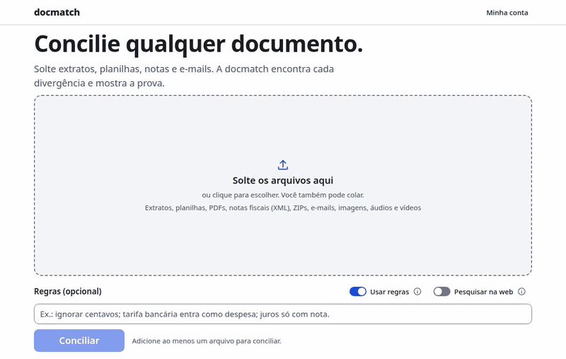
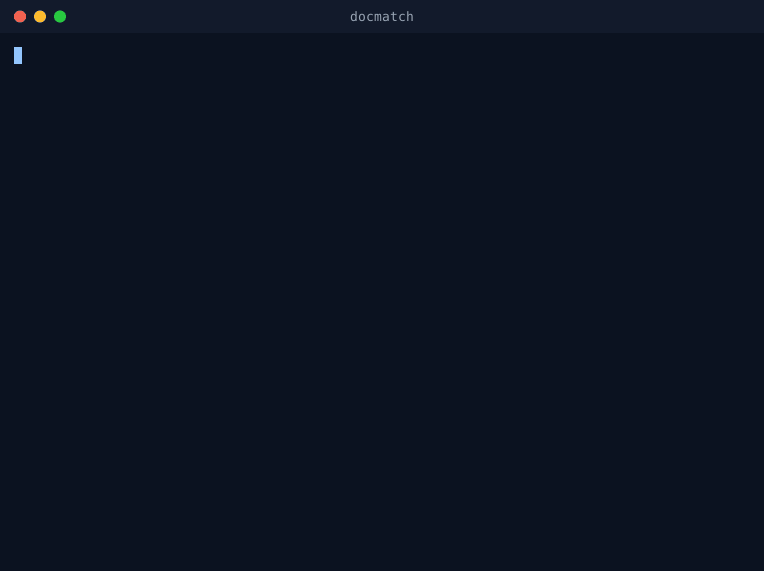

# docmatch

**Concilie qualquer documento.** Solte extratos, planilhas, notas, e-mails, áudios ou vídeos; a docmatch encontra cada divergência e mostra a prova.

A docmatch é um motor de conciliação para qualquer tipo de dado. Ela coloca cada afirmação de cada fonte em um único grafo de evidências, verifica o que concorda e o que se contradiz, e constrói novas ferramentas quando encontra um formato ou uma relação que nunca viu. Finanças são o primeiro domínio, não um caso especial: o mesmo motor concilia folha de pagamento com arquivos bancários, e-mails com contratos, notas de voz com pedidos ou replays de jogos com estatísticas.

> **Caso Vantara (amostra de conciliação financeira): 100%** — 18/18 linhas bancárias, 17/17 títulos, 23/23 achados e 11/11 totais, com dez execuções idênticas, sem modelo de linguagem (`dm eval golden`). Os dados do caso são privados e nunca entram neste repositório; o gêmeo sintético público em `testdata/golden/vantara-twin` reproduz as mesmas armadilhas e o mesmo placar.

Em produção em [docmatch.com.br](https://docmatch.com.br): site estático no CloudFront, API, worker e harness numa instância Graviton endurecida (Lynis 91) atrás dele.



<sub>O gêmeo público da Vantara no site, com o login local: envio, estimativa, achados e a evidência de um achado ([MP4](docs/media/site.mp4)). Todas as mídias são gravadas por script: `make media` ([docs/media](docs/media/README.md)).</sub>

## Começando

Um comando instala e sobe a docmatch nesta máquina, só com o Docker, sem chave de provedor e sem
login, e já concilia o gêmeo público da Vantara:

```bash
# Linux e macOS
curl -fsSL https://docmatch.com.br/install/install.sh | sh
```

```powershell
# Windows (PowerShell 5.1 ou mais novo)
irm https://docmatch.com.br/install/install.ps1 | iex
```



Os scripts conferem o SHA-256 do binário antes de instalar e não usam sudo. O mesmo comando
`docmatch` depois sobe, para e diagnostica a instalação (`docmatch status`, `docmatch doctor`,
`docmatch down`); modos, opções, checksums e solução de problemas em
[tools/installer](tools/installer/README.md).

### Para desenvolver

Pré-requisitos: Go 1.22+ (baixa a toolchain do `go.mod` automaticamente), Rust estável, Node 22 + pnpm, Docker, Terraform 1.17+.

```bash
git clone git@github.com:mmtmn/docmatch.git && cd docmatch
make setup                  # ativa os git hooks e instala ferramentas locais
make local                  # tudo nesta máquina, sem chave nem login: http://localhost:4321/app
make e2e-local              # o mesmo + Playwright no fluxo real (envio, estimativa, execução, resultados)
make local-down             # para tudo (o banco fica no volume do Docker)
```

`make local` cria o `.env` a partir do `.env.example` (gerando só os segredos locais), sobe o
Postgres e o Mailpit no Docker, aplica as migrações e roda o harness, a API, o worker e o site. O
site entra sozinho pelo login local (`DM_DEV_LOGIN`, que a API recusa fora de `DM_ENV=dev`), e a
conta local recebe créditos de desenvolvimento uma vez por dia. Para o ambiente completo de
desenvolvimento (MinIO, stripe-mock, modelo local), `make dev`.

Os apps usam a mesma API local, também sem chave. `make e2e-local-android` roda o app Android num
emulador contra o `make local`: login local, gêmeo da Vantara e a mesma conta vista de um segundo
aparelho. No Mac, `make -C apps/ios app` compila o app iOS para o simulador. Ver
[apps/android](apps/android/README.md) e [apps/ios](apps/ios/README.md).

Com `DM_LLM_MODE=local` o harness usa qualquer endpoint compatível com a API da OpenAI (Ollama, llama.cpp, vLLM). Com `openrouter` usa a sua chave da OpenRouter. Com `off` roda só a parte determinística.

## Formatos

Planilhas, extratos, CNAB, notas fiscais, e-mails, SPED e ZIP entram direto; o que ainda não é lido
aparece como aviso no resultado, arquivo por arquivo. Como cada formato é lido, os limites e todos
os avisos: [docs/formatos.md](docs/formatos.md).

| Família | Formatos | Na conciliação |
| --- | --- | --- |
| [Planilhas e CSV](docs/formatos.md#csv-tsv-e-planilhas) | CSV, TSV, XLSX, XLSM, XLS, ODS | carteira de títulos ou extrato, pelas colunas |
| [Extratos](docs/formatos.md#ofx) | OFX, [PDF com texto](docs/formatos.md#pdf) | extrato bancário (PDF digitalizado: aviso, sem OCR) |
| [CNAB](docs/formatos.md#cnab-240) | CNAB 240 (cobrança e pagamentos), [CNAB 400](docs/formatos.md#cnab-400) (retorno de cobrança) | cobrança vira carteira; pagamentos e remessa 400 ficam de fora com aviso |
| [Notas fiscais](docs/formatos.md#nf-e-e-ct-e-em-xml) | NF-e em XML | carteira, uma linha por duplicata (CT-e ainda não) |
| [E-mails e conversas](docs/formatos.md#e-mails-mbox-e-conversas-em-txt) | EML, mbox, TXT de caixa ou WhatsApp | caixa de entrada de contas a pagar (uma por execução) |
| [SPED](docs/formatos.md#sped) | EFD ICMS/IPI, EFD Contribuições, ECD | lido, fica de fora com aviso |
| [ZIP](docs/formatos.md#zip) | qualquer um dos acima | cada arquivo de dentro é uma fonte |
| [Sem suporte ainda](docs/formatos.md#sem-suporte-ainda) | imagens (OCR), áudio, vídeo, DOCX, ODT, MSG, JSON, HTML, 7z | não entram; o motivo aparece nos [avisos](docs/formatos.md#avisos) |

## Apps

O [app Android](apps/android/README.md) (Kotlin/Compose) e o [app iOS](apps/ios/README.md)
(Swift/SwiftUI) enviam documentos, confirmam a estimativa, mostram os achados com as evidências e
registram decisões na mesma conta do site. O README do Android tem o app gravado no emulador, contra
o `make local`.

## Como funciona

1. **Código primeiro, modelo depois.** Chaves, tolerâncias e somas explicam a maior parte das linhas sem gastar um token. Modelos de linguagem só veem o resíduo.
2. **Regras como hipóteses executáveis.** Inspirado nas abordagens vencedoras do ARC-AGI-3: cada regra proposta é compilada para SQL, verificada contra o histórico confirmado e mantida só se explica dinheiro sem falsos positivos.
3. **Verificação cruzada.** Um modelo de outra família reconfere cada achado contra as linhas citadas; o código recalcula cada número. Achado sem evidência é descartado.
4. **Biblioteca de ferramentas que cresce.** Formato novo? A docmatch procura uma ferramenta construída antes, testa em amostra e só então escreve uma nova, em sandbox, com testes e revisão.

## Arquitetura

```
clientes (web · Android · iOS · SDKs)
        │ HTTPS
   CloudFront ──► Caddy + API Go ──► PostgreSQL 18 (fila, ledger, regras, achados)
                        │ gRPC (socket Unix)
                   worker Go ──► harness Rust (ingestão · cascata determinística · descoberta de regras · verificação)
                        │
        Lambdas em sandbox (scanner · mídia · ferramentas geradas) · S3 (documentos) · Cloudflare R2 (mídia)
                        │ proxy de saída com lista de permissões
              OpenRouter ou modelo local · Stripe · Resend · Google/Apple
```

Detalhes em [docs/arquitetura.md](docs/arquitetura.md).

## Mapa do repositório

| Pasta | O que tem |
| --- | --- |
| `apps/web` | Site, blog e app (Astro + React), inteiramente em pt-BR |
| `apps/admin` | Painel administrativo, servido só no listener interno |
| `apps/android`, `apps/ios` | Apps companheiros (Kotlin/Compose, Swift/SwiftUI) |
| `services/api` | API e worker em Go: auth, orçamentos, tokens docmatch, uploads, fila |
| `services/harness` | Harness de conciliação em Rust: ingestão, grafo de evidências, descoberta de regras, verificação |
| `packages/contracts` | `openapi.yaml`, `harness.proto`, `limits.yaml`, códigos de erro; gera código para todas as linguagens |
| `packages/locales` | Textos em pt-BR usados por web, Android e iOS |
| `packages/design-tokens` | Cores, tipografia e espaçamento compartilhados |
| `sdks/` | Pacotes oficiais: Python, npm, Go e Rust (licença Apache-2.0) |
| `db/` | Migrações e consultas (sqlc) |
| `infra/` | Terraform, Packer e Ansible (AMI endurecida, Lynis ≥ 90) |
| `config/` | Roteamento de modelos e preços padrão, sobrescrevíveis por ambiente |
| `testdata/` | Gêmeo sintético do caso Vantara, geradores, corpora de fuzzing e de segurança |
| `docs/` | Arquitetura, decisões (ADRs), formatos, segurança, runbooks, mídias do README (`docs/media`) |
| `tools/` | Instalador (`docmatch`), runner local de CI, git hooks, lint de hardcode, geração de código, gravação das mídias (`make media`) |

## Testes

```bash
make ci        # portão completo antes de qualquer push (< 6 min): lint, unitários, integração, orçamento de consultas, scanners
make ci-full   # portão de release: e2e em 3 navegadores, carga (k6), fuzzing, ZAP, Nikto, Lynis
```

O hook `pre-push` roda `make ci`; nada sobe sem passar localmente. O GitHub Actions repete o mesmo `make ci` como segunda checagem, mas ninguém espera por ele.

## Configuração

Toda configuração vem de variáveis de ambiente ([.env.example](.env.example)). Segredos não têm valor padrão e o processo falha no boot se faltar algo obrigatório. Modelos e multiplicadores de preço ficam em [`config/`](config/) e podem ser sobrescritos por ambiente. Nada específico de uma conta, domínio ou região está no código: um fork sobe sob outro domínio editando só `.env` e `terraform.tfvars`.

## Implantando a sua cópia

1. `infra/terraform`: copie `terraform.tfvars.example`, preencha conta, região e domínio, `terraform apply` a partir de um papel com MFA.
2. `infra/packer`: gere a AMI endurecida (Ubuntu 24.04 + papel Ansible CIS; a build falha se o índice do Lynis ficar abaixo de 90).
3. Aponte os servidores de nome do domínio para a zona criada no Route 53 (ou adote a zona que o registrador já usa; ver [infra/README.md](infra/README.md)).
4. Grave os segredos no SSM Parameter Store; o `.env` de produção é renderizado no boot a partir deles. Chave de provedor que ainda não existe recebe `__EMPTY__`.
5. `infra/scripts/deploy-app.sh --env prod`: compila API, worker, migrações e harness para arm64, publica a release e instala pela SSM (sem SSH).
6. `infra/scripts/deploy-site.sh --env prod`: compila o site com os outputs do ambiente e publica no CloudFront.

## Contribuindo, segurança e licença

- [CONTRIBUTING.md](CONTRIBUTING.md): fluxo de branches, Conventional Commits, o que o `make ci` exige.
- [SECURITY.md](SECURITY.md): como reportar vulnerabilidades e o programa de recompensas (até US$ 20 por relatório válido).
- Licença: [AGPL-3.0](LICENSE) para apps e serviços; [Apache-2.0](sdks/LICENSE) para os SDKs.
