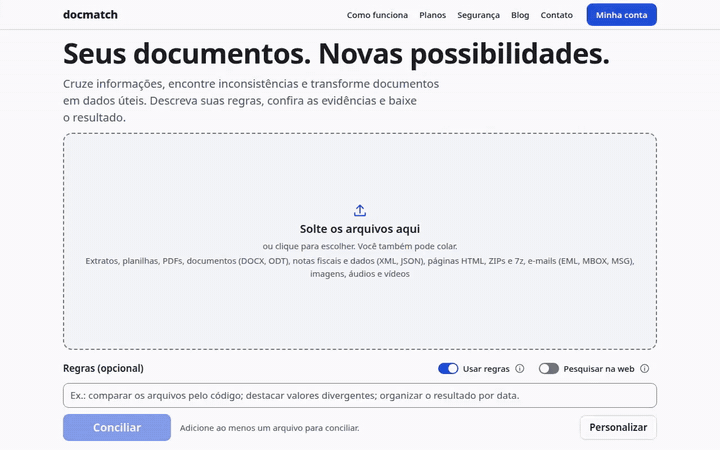
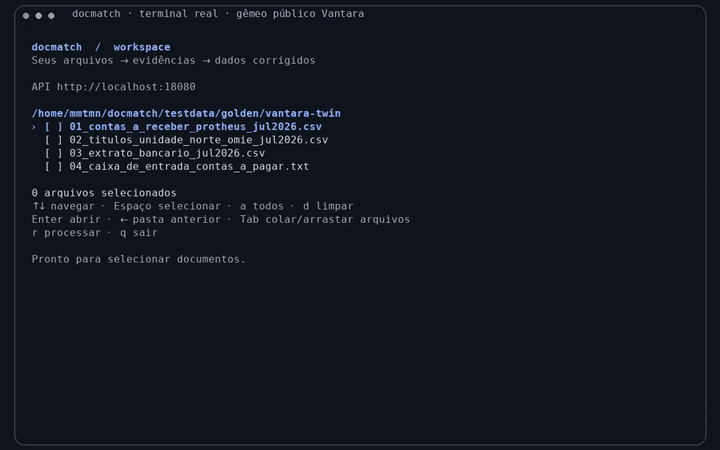
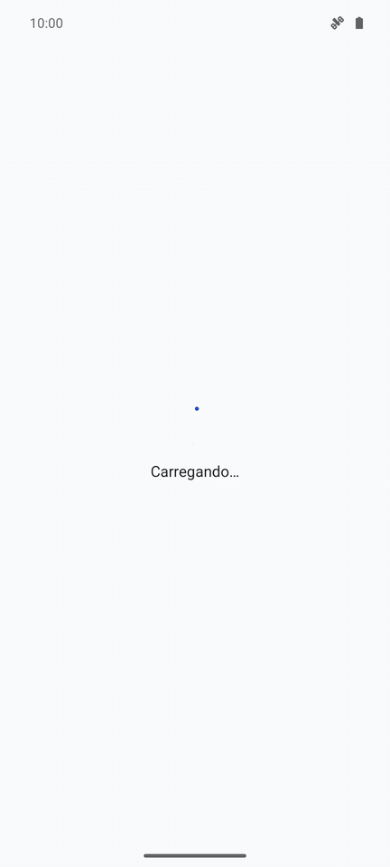
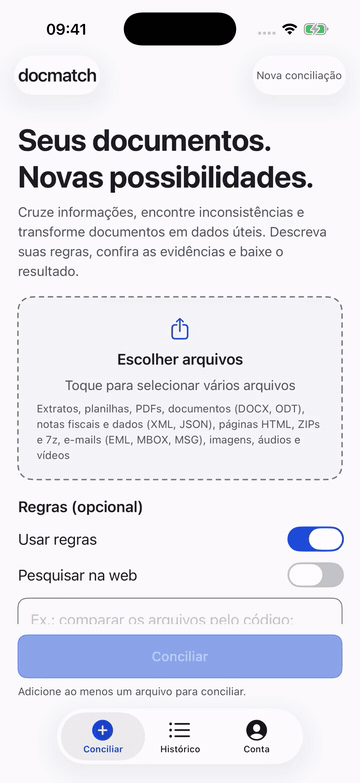

# Demonstrações verificadas

Estas são gravações de execuções reais: arquivos enviados, estimativa aprovada, processamento
com OpenRouter e revisão de resultados. Os vídeos usam exclusivamente o **gêmeo público
sintético Vantara**, com as mesmas categorias de erro do caso privado. Nenhum documento privado,
segredo ou gabarito é enviado ao modelo ou incorporado ao vídeo.

O resultado foi **100% neste caso**: 18/18 movimentos bancários, 17/17 títulos, 23/23 achados
com evidências e 11/11 totais do documento corrigido. Isso não representa uma garantia de
acurácia para qualquer documento. As sugestões de IA continuam sujeitas à revisão humana.

| Interface | Prévia acelerada (3×) | Vídeo em velocidade normal | Verificação |
| --- | --- | --- | --- |
| Site | [GIF](website.gif) | [MP4](website.mp4) | [Relatório](website-score.json), [resposta real](results/website.json) |
| Terminal | [GIF](terminal.gif) | [MP4](terminal.mp4) | [Relatório](terminal-score.json), [resposta real](results/terminal.json) |
| APK Android | [GIF](android.gif) | [MP4](android.mp4) | [Relatório](android-score.json), [resposta real](results/android.json) |
| App iOS | [GIF](ios.gif) | [MP4](ios.mp4) | [Relatório](ios-score.json), [resposta real](results/ios.json) |

### Site



### Terminal



### Android



### iOS



[Vídeo iOS em velocidade normal](ios.mp4). Capturado no simulador com a API local real e
os quatro arquivos públicos de Vantara. Não inclui credenciais nem login em uma conta Google.
O relatório iOS também passou todos os itens; o vídeo não recebe um cartão de nota sobreposto.
O [guia do app](../../apps/ios/README.md#testar-google-no-debug-com-a-api-de-produção)
explica como testar o Google com o client iOS de debug e a API de produção.

O cartão ao fim das gravações de site, terminal e Android é um **relatório externo da comparação com o gabarito**,
acrescentado após verificar o hash da resposta. Ele não simula uma tela do produto.
Os hashes de vídeos e GIFs ficam em [media.json](media.json).

## Reproduzir a nota sem rede

Instale PyYAML em um ambiente Python e rode, da raiz:

```sh
for client in website terminal android ios; do
  python tools/demos/verify_results.py \
    --expected testdata/golden/vantara-twin/expected.yaml \
    --result "docs/demos/results/$client.json" \
    --report "/tmp/docmatch-$client-score.json"
done
python tools/demos/test_verify_results.py \
  testdata/golden/vantara-twin/expected.yaml docs/demos/results/website.json
```

O verificador compara valores, regras de casamento, vínculos, classificação, evidências,
saldos confirmados/propostos e totais. Recusa linhas extras e execuções incompletas. O teste
por mutação confirma que saldo, regra, evidência, achado duplicado e total adulterados reprovam.

## Gravar novamente

Requer o stack local, um provedor real configurado em arquivo ignorado pelo Git, saldo de
QA/local suficiente, Chrome, ffmpeg e Python com `pyte`, Pillow e PyYAML. Use os comandos de
[desenvolvimento local](../desenvolvimento.md#começando) e o [instalador](../../tools/installer/README.md).
A configuração privada e os brutos das gravações ficam em `scratch/`, fora do Git.

1. Compile o terminal: `(cd tools/installer && go build -o ../../output/docmatch .)`.
2. Configure `DM_DEMO_API` e `DM_DEMO_SITE` para a API e o site locais. Os scripts usam,
   por padrão, as portas 18080 e 14321 do stack de verificação; `make local` usa 8080 e 4321.
3. Confira a interface com `node tools/demos/check-workspace.mjs`. O teste verifica três
   tamanhos de tela em claro/escuro e a prévia isoladamente, sem remover o sandbox real.
   Rode `node tools/demos/record-web.mjs` e `python tools/demos/record-terminal.py`.
4. Compile o APK e os testes com a origem correta, por exemplo:
   `(cd apps/android && ./gradlew :app:assembleDebug :app:assembleDebugAndroidTest -Pdocmatch.apiBaseUrl=http://10.0.2.2:18080)`.
5. Num emulador isolado, rode
   `ANDROID_SERIAL=emulator-5556 python tools/demos/record-android.py`.
   O script limpa os dados do app de demonstração. Recusa dispositivos físicos e um APK de
   testes cujos assets não correspondam ao gêmeo público. O picker recebe os quatro arquivos
   pelo harness de teste; upload, modelo e processamento usam a rede real.
6. Capture `GET /v1/runs/{id}` e todos os achados das três execuções com uma sessão local,
   no formato `{ "run": ..., "findings": [...] }`. Salve em `docs/demos/results/`, rode o
   verificador acima com `--report docs/demos/<client>-score.json` e confira os IDs gravados.
7. `python tools/demos/package-media.py` gera MP4/GIF e o cartão a partir dos relatórios aprovados.
   O script exige exatamente uma gravação web no diretório de entrada.

O terminal é capturado por PTY; os frames são renderizados dos caracteres ANSI recebidos.
A animação e o progresso vêm do aplicativo. Não são uma sequência de telas desenhadas.

### Gravar o iOS no Mac

Use um simulador isolado, iniciado e com nome começando por `docmatch `; abra Arquivos uma
vez para inicializar o armazenamento local. A API local precisa estar ativa, com login de
desenvolvimento. O gravador usa o seletor nativo e recusa arquivos diferentes do gêmeo público.

```sh
python3 tools/demos/record-ios.py --simulator UUID_DO_SIMULADOR --api http://localhost:18080
python3 tools/demos/package-ios.py --source scratch/ios-demo/ios-raw.mp4 --start INICIO --duration DURACAO
```

Substitua `INICIO` e `DURACAO` pelos segundos do trecho revisado, excluindo a abertura do runner
e o encerramento do teste. O MP4 mantém a velocidade normal; o GIF usa 3×. O empacotador usa
`FFMPEG` ou `imageio_ffmpeg` e atualiza somente a entrada iOS de `media.json`, sem acrescentar
cartão. Para registrar a verificação, capture a resposta e os achados da execução filmada,
rode `verify_results.py` e passe também `--report docs/demos/ios-score.json
--result docs/demos/results/ios.json`; o empacotador confere os hashes e o ID antes de marcar
o benchmark como verificado. Os brutos e logs ficam em `scratch/`, fora do Git.

## Outras verificações desta entrega

Os exemplos dos quatro [SDKs](../../sdks/README.md) passaram o mesmo fluxo real e o mesmo
verificador, incluindo exportação XLSX. A chave temporária foi revogada depois do teste.
O caso privado também passou em uma nova execução com Ollama e outra com OpenRouter:
18/18 linhas, 17/17 títulos e 23/23 achados com evidências preservadas, seis chamadas reais
por execução. Seus documentos, valores e logs não são publicados.
