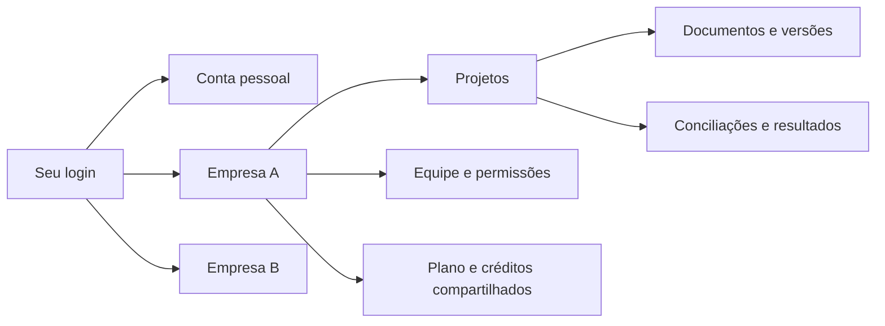

# Plano de projetos equipes extensões e documentação

## Situação em 7 de novembro de 2026

A [release 0.2.0](https://github.com/mmtmn/docmatch/releases/tag/v0.2.0) reúne os pacotes e
comandos de instalação. O plano abaixo conserva os critérios usados na implementação.

| Entrega | Situação verificada |
| --- | --- |
| Projetos, equipes e duas permissões | Habilitados em produção. Migração, aceite de convite, isolamento, mudança de função e revogação ensaiados em cópia isolada; conversão de conta e preservação de projetos/créditos verificadas também em produção. |
| Ação fixa e arquivos expansíveis | Implementados na web, nos apps e nas extensões; testes de navegação, telas pequenas e acessibilidade passaram. |
| Python, Rust e Go | 0.2.0 publicada e instalada fora do checkout; projetos e reaproveitamento de resultados verificados contra produção. Go é público. |
| Terminal e TypeScript | Terminal 0.2.0 disponível pelo site; TypeScript anexado à release. Publicação npm e imagens GHCR aguardam autenticação. |
| Chrome, Firefox e Safari | Prévias preparadas; acesso de extensão em produção ainda limitado às contas de teste. Chrome/Firefox passaram pelo fluxo completo. Safari conectou e criou projeto; o envio final aguarda interação local com o seletor de arquivos do macOS. |
| Android e iOS | Testes locais passaram; AAB e archive de produção preparados sem assinatura de distribuição. Lojas e validação real com Apple ainda pendentes; nenhuma chave App Store Connect utilizada. |
| Site e livros | Links de plataformas e aviso com consentimento implementados; dois livros publicados, com busca e capítulos verificados nos três motores de navegador. |
| AWS e backups | API/worker/harness implantados, esquema 43; restauração, backup diferencial e arquivamento contínuo verificados. Capacidade mantida; somente os custos S3 de backup autorizados. |

Ainda faltam contas e submissões às lojas, autenticação npm/GHCR, conclusão do teste Safari,
ampliação das extensões e duas rodadas de usabilidade com participantes reais. Automação não
substitui essas rodadas. Os resultados de restauração estão no [registro operacional](runbooks/restaurar-backup.md#registro).

## Plano e critérios

A próxima etapa transforma conciliações avulsas em trabalho que pode ser retomado e
compartilhado. A ordem recomendada é **contas e permissões → projetos → equipes →
paridade mobile e SDKs → extensões → distribuição pública**. O livro e a área de
disponibilidade do site acompanham as entregas desde o início.

Decisões já definidas: pessoas adicionais **sem cobrança por assento inicialmente**;
extensões com envio de documentos, conciliação e resultados; desenvolvimento local antes
de produção e das lojas. Este plano complementa o [plano mestre](plano-mestre.md), com
entregas verificáveis, sem calendário fixo.

## O que já existe e o que precisa mudar

| Base encontrada | Consequência para esta etapa |
| --- | --- |
| Usuários, organizações, vínculos e isolamento por organização no PostgreSQL. O login escolhe o vínculo mais antigo. | Reaproveitar essa base, acrescentando seleção explícita da conta e validação do vínculo em cada operação. |
| Sessões de operações não carregam uma política de permissões por função; chaves de API têm escopos próprios. | Convidar pessoas só depois de proteger uploads, projetos, regras, resultados e gastos no servidor. |
| Rascunho web cifrado no IndexedDB, com um único identificador local. | Ele não é um projeto sincronizado. Separar rascunhos por pessoa, conta e projeto; salvar o projeto no servidor. |
| Uploads, orçamentos assinados, fila, créditos, resultados e e-mail transacional já implementados. | Estender o fluxo existente, preservando aprovação do custo e trilha de auditoria. |
| Identificador do conteúdo já protege o orçamento, mas não impede uma nova execução igual com outro pedido. | Criar uma regra própria para reaproveitar resultados e impedir cobrança duplicada. |
| Retenção atual de 30 dias nos dois primeiros planos e 365 no maior. | Projeto salvo não pode prometer arquivos eternos sem uma decisão explícita de armazenamento. |
| Web com envio central; Android e iOS com Conciliar, Histórico e Conta. | Introduzir Projetos com a mesma linguagem visual, sem transformar a página inicial em um painel complexo. |
| SDKs publicados e scripts locais de implantação por AWS CLI/SSM. | Evoluir contratos sem quebrar clientes antigos e corrigir o runbook que ainda pressupõe builds automáticos no GitHub. |

Evidências: [contas](../services/api/internal/account/model.go),
[sessões](../services/api/cmd/api/main.go), [rascunho](../apps/web/src/lib/draftStore.ts),
[execuções](../services/api/internal/runs/service.go) e [retenção](../config/pricing.yaml).
O estudo visual considerou o site público, os componentes web e os fluxos Android/iOS.

## Uma pessoa várias contas

Uma pessoa mantém um login e pode participar de sua conta pessoal e de várias empresas.
Cada conta tem seus projetos, participantes, plano e saldo. Aceitar um convite acrescenta
um vínculo; não troca o e-mail, não cancela uma assinatura e não mistura arquivos.

No app web, o canto superior esquerdo mostra **Conta pessoal ▾** ou o nome da empresa.
O menu lista as contas, a permissão em cada uma e os convites pendentes. Dentro da conta:
**Projetos**, **Atividade** e, para o responsável, **Equipe e plano**. Perfil, senha e
dispositivos ficam em **Meu perfil**. No celular, o mesmo seletor abre uma folha de opções;
a navegação principal passa a **Projetos · Atividade · Conta**, com **Novo projeto** visível.

No projeto, manter a ação **Conciliar ou ver resultado** fixa no rodapé, acima das abas nos
apps. Arquivos começam recolhidos, com contagem de prontos e aviso de problemas; a pessoa
pode expandir a lista e rolar sem perder a ação. As opções de conciliação também começam
recolhidas. Reservar espaço para o botão, teclado e área segura, inclusive com texto ampliado.

Mostrar a conta também na confirmação de custo e no upload. Cada aba, requisição e envio
mantém seu destino: mudar uma aba para B não pode fazer outra gastar ou enviar arquivos em B.

Contas existentes conservam IDs, dados e cobrança. Para transformar uma conta paga pessoal
em equipe, oferecer um fluxo explícito: nome da empresa, o que continuará nela e criação
de um espaço pessoal separado, se necessário. Projetos anteriores ficam privados ao dono
até ele compartilhar. Nunca converter nem compartilhar automaticamente no primeiro convite.

## Projetos que podem ser retomados

**Criar → adicionar documentos → salvar → conciliar → voltar ao resultado.** Nome editável,
salvamento automático e estados **Salvando**, **Salvo na conta** e **Aguardando conexão**.
Só confirmar o salvamento após recebimento no servidor; um envio interrompido pode exigir
selecionar novamente o arquivo local.
Cada arquivo mostra **Enviando**, **Em verificação**, **Pronto** ou **Rejeitado**. Conciliar
somente documentos prontos, sem retirar arquivos com erro silenciosamente.

A lista mostra nome, última alteração, documentos e situação. Ao voltar: **“2 documentos
adicionados desde a última conciliação”**. O projeto tem **Documentos**, **Resultados** e
**Atividade**; regras próximas do botão Conciliar. Permitir renomear e arquivar; confirmar
exclusão. Substituir um arquivo cria uma versão, preservando a referência de resultados anteriores.

**Conciliação concluída** não significa **documentos sem divergências**. Mostrar evidências,
custo e próximos passos, distinguindo interpretação da IA de fatos confirmados.

Manter o envio rápido na página pública. No app, Projetos vira a entrada; Conciliar cria um
projeto com nome sugerido. Histórico antigo oferece **Salvar como projeto**, sem agrupamento
automático. Listas e livros podem rolar; a primeira tela compacta não deve esconder conteúdo
com zoom, teclado aberto ou texto ampliado.

Experimentos de Altmann e Trafton associam pistas de contexto à retomada de tarefas.
Isso orienta a proposta de mudanças recentes; o layout ainda exige teste com usuários.
[Estudo sobre interrupção e retomada](https://www.interruptions.net/literature/Altmann-CogSci04.pdf).
As diretrizes de Amershi e colaboradores sustentam explicações, controle e correção nas
interações com IA. [Estudo de interação humano IA](https://www.microsoft.com/en-us/research/wp-content/uploads/2019/01/Guidelines-for-Human-AI-Interaction-camera-ready.pdf).

### Quando o botão pode executar novamente

| Situação | Comportamento |
| --- | --- |
| Mesmo conteúdo e mesmas regras, resultado válido já concluído | **Ver resultado**. Explicar que nada mudou; não criar execução nem reservar créditos. |
| Mesma análise já em andamento | **Acompanhar conciliação**. Reutilizar a execução existente. |
| Execução aguarda aprovação de custo adicional | **Revisar limite** na execução existente; exigir permissão e nova aprovação. |
| Documento adicionado, retirado ou substituído; regra ou opção de análise alterada | **Conciliar alterações**, com nova estimativa e aprovação. |
| Execução falhou ou foi cancelada | Permitir nova tentativa, mostrando a nova estimativa e o que já foi cobrado ou liberado. |
| Somente nome do projeto ou ordem visual mudou | Continuar mostrando o resultado existente. |
| Resultado expirou ou está indisponível | Explicar o problema e tentar recuperar. Reprocessamento exige motivo, estimativa e aprovação explícitos. |

O servidor compara conteúdo verificado, versões, papéis dos documentos, regras efetivas e
opções relevantes. Novo ID de upload, preço ou ordem visual não cria trabalho novo. Preservar
fontes iguais intencionalmente distintas. Versionar regras aprendidas e fontes externas;
atualização de modelo ou passagem do tempo não autoriza cobrança automática.

Verificar antes de reservar créditos, protegendo a operação contra concorrência. Cliques
simultâneos em qualquer cliente retornam a mesma execução. Uma edição após a estimativa exige
atualizá-la. Resultados apontam para versões imutáveis; novos arquivos não alteram análises passadas.

**Retenção a fechar antes do lançamento:** manter nome e histórico até exclusão, preservando
inicialmente os prazos atuais para originais/resultados, com vencimento e exportação visíveis.
Abrir ou arquivar não renova o prazo. Arquivo expirado aparece como indisponível. Arquivos
permanentes exigiriam antes limites, orçamento de armazenamento e novas regras de limpeza no S3.

## Equipe com duas permissões simples

Usar **Pessoas** ou **Equipe**. O dono informa e-mail, permissão e projetos compartilhados.
Todos os planos pagos podem convidar sem preço por pessoa; consumo e limites são da conta.
Não adicionar assentos à cobrança Stripe. Limites contra abuso ficam configuráveis e visíveis.

| Ação | Apenas adicionar documentos | Acesso completo aos projetos | Responsável pela conta |
| --- | --- | --- | --- |
| Encontrar projetos compartilhados e enviar arquivos | Sim | Sim | Sim |
| Ver o recebimento dos próprios envios | Sim | Sim | Sim |
| Ler outros documentos, resultados e exportar | Não | Sim, nos projetos compartilhados | Sim |
| Criar projetos, editar regras e conciliar | Não | Sim | Sim |
| Renomear, arquivar e remover documentos/projetos | Não | Sim, nos projetos compartilhados | Sim |
| Gerir convites, permissões, cobrança e chaves de API | Não | Não | Sim |

“Acesso completo” aos projetos não administra a empresa. Mapear os papéis atuais `owner`,
`admin`, `member` e `viewer` sem mudar permissões silenciosamente. Autorizar por **pessoa,
vínculo ativo, conta, projeto e ação**. Essa separação parte do modelo de
[controle por papéis do NIST](https://www.nist.gov/publications/nist-model-role-based-access-control-towards-unified-standard)
e da validação por requisição recomendada pela
[OWASP](https://cheatsheetseries.owasp.org/cheatsheets/Authorization_Cheat_Sheet.html).

O convite segue **Pendente → Aceito**, ou **Recusado / Expirado / Revogado**. Token aleatório
armazenado como hash, com prazo e reenvio limitado. Abrir o link não aceita: a pessoa entra
ou cria conta, comprova o endereço convidado e confirma por POST protegido contra CSRF.
Verificadores automáticos de e-mail não podem aceitar convites.

Com outro endereço conectado, oferecer troca de conta ou verificação de endereço adicional;
nunca fundir identidades automaticamente, inclusive endereços privados da Apple. Aceite repetido
não duplica vínculos; reenvio invalida o link anterior. Usar a fila transacional existente.

Remover alguém revoga seu vínculo, inclusive em sessões e extensões abertas; sua conta pessoal
permanece. Downloads temporários têm prazo curto, sem prometer revogação instantânea de links
já emitidos. O último responsável precisa transferir a função antes de sair/excluir seu login.
Rever exportação e exclusão para proteger dados de colegas. Assinatura inativa bloqueia novos
gastos e explica quais resultados continuam disponíveis.

## Extensões completas nos três navegadores

Uma base TypeScript compartilhada, com adaptadores e pacotes próprios de Chrome, Firefox
e Safari. A primeira versão inclui **escolher conta/projeto, enviar, ajustar regras, estimar,
aprovar, acompanhar, consultar evidências e baixar resultados**, respeitando as permissões.
Usar os preços do app e o saldo da conta selecionada, sem aplicar o multiplicador de uma
chave de API só porque o código reaproveita um SDK.
Capturar páginas completas, monitorar downloads automaticamente e integrações específicas
com sites ficam fora desta primeira versão.

O popup serve para ações curtas e projetos recentes. O trabalho completo abre uma página da
própria extensão, com espaço para arquivos e resultados; painel lateral é uma melhoria onde
for compatível. A execução acontece no servidor e continua quando a janela fecha. Reabrir
recupera seu estado. Upload interrompido precisa de recuperação explícita; não prometer que
o navegador manterá um arquivo local disponível para sempre.

| Navegador | Validação local | Distribuição |
| --- | --- | --- |
| Chrome | Pacote descompactado; Manifest V3; reinício do processo de fundo e perda de conexão. | Chrome Web Store, descrição do uso de dados, justificativa de permissões e conta de teste. |
| Firefox | `web-ext` ou instalação temporária; testar permissões também no pacote assinado. | Assinatura Mozilla e publicação no AMO. |
| Safari | Pasta temporária no Safari macOS; Xcode/simulador e dispositivo para integração iOS. | Apple Developer Program, TestFlight e App Store; integrar ao app iOS existente quando adequado. |

O processo de fundo do Chrome pode ser encerrado pelo navegador; Firefox e Safari têm
diferenças de execução. Não manter todo o estado em memória nem assumir um manifesto idêntico.
[Ciclo de vida do Chrome](https://developer.chrome.com/docs/extensions/develop/concepts/service-workers/lifecycle),
[compatibilidade de background](https://developer.mozilla.org/en-US/docs/Mozilla/Add-ons/WebExtensions/manifest.json/background),
[assinatura Firefox](https://extensionworkshop.com/documentation/publish/signing-and-distribution-overview/).
A Apple oferece teste temporário e opções de empacotamento, incluindo App Store Connect;
Xcode continua útil para a integração nativa escolhida.
[Safari local](https://developer.apple.com/documentation/safariservices/running-your-safari-web-extension),
[distribuição Safari](https://developer.apple.com/documentation/safariservices/packaging-and-distributing-safari-web-extensions-with-app-store-connect).

**Primeiro experimento técnico:** autenticar e ler um projeto nos três navegadores.
Chrome/Firefox oferecem `identity.launchWebAuthFlow`; Safari não, conforme os
[dados de compatibilidade Mozilla](https://github.com/mdn/browser-compat-data/blob/main/webextensions/api/identity.json).
Prototipar a ponte nativa Safari com o fluxo de login do app, antes de assumir paridade.
Usar autorização com código, PKCE, destinos de retorno permitidos e credenciais curtas e
revogáveis, conforme [OAuth Security BCP](https://www.rfc-editor.org/rfc/rfc9700.html).
Isso exige uma autorização para a extensão no backend, não apenas reaproveitar o login Google.

Não embutir chave de API do dono nem copiar cookies de páginas. Credenciais ficam no contexto
privilegiado da extensão, inacessíveis ao conteúdo da página; evitar sincronização de tokens.
Permitir apenas origens necessárias da API e uploads. Solicitar acesso à página atual somente
se uma ação realmente precisar dele, usando permissões pontuais como
[`activeTab`](https://developer.chrome.com/docs/extensions/develop/concepts/activeTab).
Validar mensagens recebidas, não executar código remoto e limpar dados locais ao sair.
Documentos e conteúdo capturado continuam passando pela mesma varredura do servidor.

A sequência de entrega é **API local + dados sintéticos → staging → beta limitada em produção
→ lojas → links públicos**. IDs, retornos de login e origens são separados por ambiente;
o pacote de produção não habilita login de desenvolvimento ou acesso genérico à rede local.
Revalidar as políticas das lojas na submissão, inclusive consentimento para transmissão de
documentos. [Publicação Chrome](https://developer.chrome.com/docs/webstore/publish) e
[políticas Mozilla](https://extensionworkshop.com/documentation/publish/add-on-policies/).

## Site com destinos claros e aviso de disponibilidade

Acrescentar uma faixa discreta **Use onde preferir**, abaixo da área principal e no rodapé:
Android, iOS e GitHub; extensões entram conforme forem prontas. Ícone acompanhado do nome,
alvo confortável para toque e estado visível. Não ocupar a área de envio com novos chamados.

Cada destino tem configuração única: `coming_soon`, `beta` ou `available`, endereço e nome.
Disponível abre o endereço validado; beta explica o acesso; indisponível mostra **“Em breve.
Quer receber um aviso por e-mail?”**, com ação **Avisar-me**. Essa ação abre um formulário
acessível, sem prazo para preencher. A mensagem inicial não rouba o foco e permanece tempo
suficiente para ser acionada; o formulário controla foco e o devolve ao botão ao fechar.
[Mensagens de estado](https://www.w3.org/WAI/WCAG22/Understanding/status-messages.html) e
[diálogos acessíveis](https://www.w3.org/WAI/ARIA/apg/patterns/dialog-modal/).

Registrar interesse por plataforma, confirmação do endereço, finalidade e cancelamento.
O e-mail de lançamento é separado da preferência geral de marketing; não inscrever alguém
automaticamente nem revelar se já está cadastrado. Deduplicar, limitar tentativas e usar a
fila de e-mail existente. A notificação só sai quando o destino estiver pronto.

Usar arquivos oficiais e guardar origem, atribuição e condições de uso. Android exige
atenção à atribuição do robô; GitHub tem materiais próprios para links. No iOS, usar o badge
App Store aprovado quando houver destino elegível; enquanto pendente, texto **iOS · Em breve**.
A Apple proíbe substituir esse material pelo logotipo Apple isolado.
[Android](https://developer.android.com/distribute/marketing-tools/brand-guidelines),
[GitHub](https://docs.github.com/en/site-policy/other-site-policies/github-logo-policy),
[Apple](https://developer.apple.com/app-store/marketing/guidelines/).

GitHub só vira link público após acesso anônimo funcionar e a revisão de arquivos e histórico
antes de abrir o repositório. Os apps também precisam das verificações de distribuição já
documentadas: assinatura e OAuth de produção no Android; no iOS, inclusive a pendência de
revogar tokens Apple na exclusão da conta. Ver [Android](../apps/android/README.md) e
[iOS](../apps/ios/README.md). Um build local bem-sucedido não define `available`.

## Um livro com duas portas de entrada

Usar **mdBook**, o gerador utilizado pelo Rust Book, com tema docmatch, busca, índice lateral,
capítulos curtos, navegação anterior/próximo e leitura confortável no celular.
[Documentação do mdBook](https://rust-lang.github.io/mdBook/).

| Guia para usar | Guia para integrar e desenvolver |
| --- | --- |
| Primeiro projeto com dados públicos de exemplo. | Primeira integração executável em cada SDK. |
| Adicionar arquivos, salvar e voltar depois. | Autenticação, conta selecionada e permissões. |
| Convidar pessoas e alternar contas. | Projetos, versões, uploads e proteção contra repetições. |
| Entender estimativas, créditos, evidências e divergências. | API, erros, paginação, limites e compatibilidade. |
| Apps, extensões, privacidade e ajuda. | Desenvolvimento local, arquitetura e operação. |

Os títulos públicos são **Usar a docmatch** e **Integrar e desenvolver**, sem classificar
pessoas como técnicas ou não técnicas. Dentro de cada guia, separar aprendizado inicial,
tarefas, referência e explicações, seguindo [Diátaxis](https://diataxis.fr/). Não é preciso
duplicar um capítulo quando um link resolve; comandos vêm de exemplos testados, referência
da API do OpenAPI e limites de configuração. Explicar o que é uma conciliação antes de falar
de endpoints. As duas entradas começam em pt-BR, como o produto.

Proposta de origem: `docs/book/usuario` e `docs/book/desenvolvedor`; publicação estática em
`/docs/usar/` e `/docs/desenvolver/`, com versão identificada e seletor quando houver mais de
uma versão mantida. Separar o livro público dos runbooks internos; apenas arquivos selecionados
entram no build. Nunca publicar toda a pasta `docs` automaticamente.

A integração exige ajustar a reescrita de URLs do CloudFront, hoje voltada a páginas Astro
`.html`, e validar CSP, busca e links profundos do mdBook. Empacotar site e livro juntos ou
proteger seus prefixos: o `aws s3 sync --delete` do site não pode apagar o livro. O README
principal recebe apenas um link claro para o livro e mantém os links curtos de SDKs.

## Entregas na ordem de construção

| Etapa | Entrega | Só avança quando |
| --- | --- | --- |
| 1. Protótipo e decisões | Seletor de conta, lista/projeto, convite, duas permissões; decisão de retenção; experimento de login nas extensões. | Pessoas representativas retomam o projeto, identificam a conta e entendem quem pode gastar. Safari tem caminho de login demonstrado. |
| 2. Base comum | Permissões no servidor, contexto por requisição, contratos e migrações compatíveis; auditoria. | Testes negam acesso entre contas e ações além da permissão, inclusive com sessão antiga e chaves de API. |
| 3. Projetos web | Salvamento, versões, histórico, assinatura da análise e reaproveitamento de resultados. | Fechar e voltar em outro dispositivo funciona; pedidos concorrentes iguais geram no máximo uma execução e uma reserva. |
| 4. Equipes | Convite, aceite, troca de conta, remoção e proteção do último responsável. | Usuário novo, existente, com conta paga e em várias empresas completam o fluxo sem mistura de dados ou cobrança por assento. |
| 5. Todos os clientes | Android, iOS e SDKs Python, Go, Rust e TypeScript; exemplos e livro. | O mesmo roteiro funciona nos clientes e a versão anterior suportada continua operando. |
| 6. Extensões | Fluxo completo nos três navegadores, instalação local e beta em produção. | Fechar/reabrir, perda de rede, sessão vencida e revogação não perdem o estado confirmado nem duplicam cobrança. |
| 7. Distribuição | Lojas, publicação dos SDKs, livro, links oficiais e lista de avisos. | Artefatos instalados dos destinos reais funcionam; disponibilidade do site corresponde à realidade. |

O livro começa na etapa 1 e cresce com os fluxos aprovados. Faixa do site e lista de avisos
podem ser entregues antes das extensões, assim que suas próprias verificações passarem.

### Onde cada entrega entra

| Área | Mudança prevista |
| --- | --- |
| API e banco | Projetos, versões de documentos, vínculo projeto/execução, acesso a projetos, convites e interesse por plataforma. Índices por conta e relações que não aceitem IDs de outra organização. Reutilizar uploads, RLS, fila e créditos. |
| Contratos | OpenAPI, erros, limites e catálogos gerados. Identificador do projeto opcional durante transição; operações restritas exigem contexto suficiente para autorizar. |
| Web | `HeroApp`, navegação de conta, nova área de projetos/equipe, rascunhos separados e site. O atual `workspace` de personalização visual continua com seu propósito. |
| Android e iOS | Clientes Kotlin/DocmatchKit, modelos de sessão, seletor, projetos, links de convite, retomada e invalidação de caches. Textos em `packages/locales`, aparência em `packages/design-tokens`. |
| SDKs e terminal | Métodos de projetos, documentos e resultados, códigos de acesso negado/resultado existente e exemplos. API keys continuam ligadas a uma conta; não permitir trocar sua conta por header. Atualizar o terminal consumidor do SDK Go. |
| Extensões | Nova pasta `apps/extensions`, núcleo compartilhado, adaptadores por navegador, manifests por ambiente e integração Safari ao projeto Apple. |
| Livro e site | Build selecionado do mdBook, navegação, busca, logos oficiais e cadastro de avisos. Atualizar exemplos, README e guias no mesmo PR da funcionalidade. |
| Infra e GitHub | Migrações, armazenamento, CSP/CORS, e-mail, alarmes, flags, scripts AWS CLI, CI local e pacotes de release. |

No contrato, distinguir códigos estáveis para projeto alterado, execução existente e acesso
negado. Reusar um resultado é uma resposta útil, não uma falha genérica que provoque retries.

## Migração e produção sem surpresas

Adicionar tabelas e campos primeiro; manter uploads e execuções existentes utilizáveis.
Não mover arquivos nem créditos entre organizações automaticamente. Adotar versões de
projeto para detectar edição concorrente e IDs imutáveis no trabalho enviado ao worker.
Não reaproveitar a tabela de personalização visual como projeto.

Antes de habilitar convites, autorizar também endpoints legados. Clientes antigos podem
continuar atendendo o dono; uma função restrita não ganha poderes porque usa um SDK antigo.
Nas novas versões dos SDKs, testar criação de projeto, envio, conciliação, repetição sem custo,
paginação e erros de permissão. Publicar novas versões e manter `0.1.0` intacta; Go continua
usando tags `sdks/go/v...`. Publicar TypeScript no npm quando sua preparação estiver completa.

Implantação: **local → staging isolado → produção limitada → ampliação**. Usar flags por conta
para projetos, convites e extensões. Os recursos AWS vêm de configuração/Terraform. O operador
confere identidade AWS, ambiente, backup recuperável e checksum do commit antes de executar os
scripts [deploy-app](../infra/scripts/deploy-app.sh) e [deploy-site](../infra/scripts/deploy-site.sh),
que usam AWS CLI, S3, SSM e CloudFront. Validar também limpeza de documentos, e-mails e escopos
de acesso nas URLs de download. [Referência de SSM Run Command](https://docs.aws.amazon.com/cli/latest/reference/ssm/send-command.html).

Atualizar o [runbook](runbooks/implantar.md) para o processo realmente implementado: não esperar
um GitHub Actions que não dispara automaticamente, nem prometer ausência de interrupção quando
o script reinicia serviços. Ensaiar migração, falha e volta ao binário anterior com esquema
compatível. Rollback não apaga dados já aceitos; flags interrompem novas operações quando preciso.

Cada PR inclui código, contratos, migração, testes e documentação afetados. `make ci` é o
portão local; `make ci-full` e o roteiro de ponta a ponta fecham releases em staging.
Acrescentar extensões e livro ao escopo desses comandos, sem ligar runners pagos automaticamente.
Publicar artefatos identificados pelo commit e testar instalação real antes de anunciar.

## Como saber que ficou simples e correto

Fazer duas rodadas pequenas de testes de uso com responsáveis, pessoas que só enviam e
conciliadores, incluindo pessoas pouco técnicas e quem trabalha para várias empresas.
São testes qualitativos para encontrar problemas, não prova estatística de um percentual.
Usar protótipos antes da implementação e os clientes reais depois.

Roteiro de aceitação compartilhado:

1. Criar “Fechamento mensal”, enviar arquivos e voltar em outro dispositivo. Ver apenas dados
   confirmados, recuperar o contexto e entender vencimentos.
2. Conciliar; tentar novamente sem alteração, inclusive pelo SDK e em duas abas. Reabrir o
   resultado sem nova execução ou crédito reservado. Adicionar um arquivo e receber nova estimativa.
3. Aceitar convite com conta existente, com outro e-mail conectado e depois de expirar/revogar
   o link. Nenhum caso compartilha dados antes da aceitação válida.
4. Alternar conta pessoal e duas empresas, inclusive durante upload. Confirmar destino e saldo
   corretos; testar URLs adivinhadas, exportações e troca de IDs entre contas.
5. Como pessoa de envio, tentar conciliar pela interface e diretamente pela API. Ambas recusam.
   Remover o vínculo e conferir acesso em web, mobile, extensão e sessões já abertas.
6. Usar Chrome, Firefox e Safari para estimar, aprovar, fechar, voltar e consultar o mesmo resultado.
   Verificar download, reinício do navegador e separação entre ambientes.
7. Navegar com teclado, leitor de tela e texto ampliado. Confirmar conta, permissões, estados
   de upload e formulário de aviso sem depender apenas de cor ou de mensagem passageira.
8. Instalar cada release publicada; abrir capítulos do livro por link direto; testar aviso
   de plataforma indisponível e cancelamento do e-mail.

Medir tempo para retomar um projeto, sucesso ao aceitar convites, erros de contexto, uploads
confirmados, tentativas repetidas reaproveitadas, custo por conciliação e falhas de publicação.
Não registrar conteúdo de documentos, tokens ou e-mails em métricas de uso.

Antes da implementação, fechar somente os detalhes ainda abertos: prazo de retenção de
projetos, limites operacionais de participantes/armazenamento e versões mínimas dos navegadores.
As permissões propostas e o fluxo de transformar uma conta em equipe devem ser confirmados
nos protótipos. A primeira entrega concreta é esse protótipo junto do contrato de permissões
e do teste de login Safari; as etapas seguintes dependem desses resultados.
